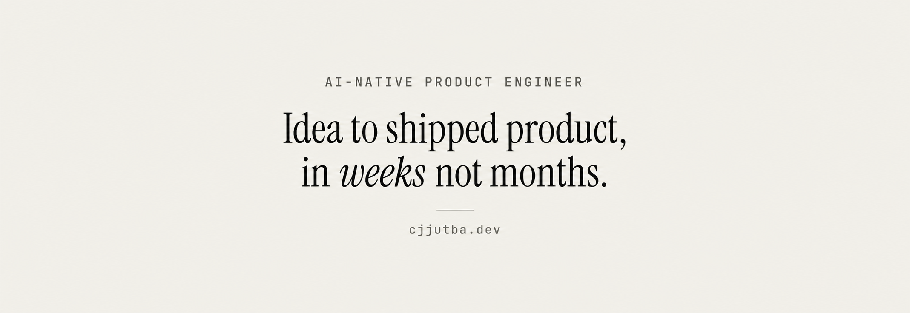

  
  
  
  
  

## AI-native product engineer

I build web apps, SaaS and MVPs for founders and startups, shipped in weeks, not months.

Being AI-native means I plan the work in detail, agents build separate parts of it in parallel, and I review every line that ships. The review is why fast never means fragile.

## Selected work

- **[Fiscplus](https://cjjutba.dev/work/fiscplus).** A multi-tenant SaaS for a Belgian accounting firm. Three role-scoped portals, real-time sync and a complete anti-money-laundering module, built solo and still in active development. Private client.
- **[Kernel](https://github.com/cjjutba/kernel).** A Mac app where Claude Code and Codex agents work on one repo as a small team, each in its own git worktree. Nine public releases in its first eight days.
- **[Kalinga](https://github.com/cjjutba/kalinga).** Booking, records and recall reminders for small vet clinics. Built in four days.
- **[Quarter](https://cjjutba.dev/work/quarter).** Rooms, meter readings and rent for a boarding house, run from a phone at the gate.

## How I work

I own the whole project. Scoping, architecture, build, deployment and a handoff the next engineer can pick up. The code is yours to keep.

Evidence before claims. The proof is in the [case studies](https://cjjutba.dev/work), not the pitch.

## Tech

  

## Recently active

<!-- REPOS:START -->
- **[starter-kit-web](https://github.com/cjjutba/starter-kit-web)**. The repo every new product starts from. Last push Oct 24, 2026.
- **[kernel](https://github.com/cjjutba/kernel)**. A Mac app where Claude Code and Codex agents work as a team. Last push Oct 23, 2026.
- **[homebrew-tap](https://github.com/cjjutba/homebrew-tap)**. Homebrew tap for Kernel. Last push Oct 17, 2026.
- **[kalinga](https://github.com/cjjutba/kalinga)**. Booking, records and recall reminders for veterinary clinics in the Philippines. Last push Sep 7, 2026.
- **[upnext](https://github.com/cjjutba/upnext)**. Courtside pickleball open play manager. Last push Sep 4, 2026.
<!-- REPOS:END -->

## Latest writing

<!-- POSTS:START -->
- [From idea to shipped, my AI-native engineering workflow](https://cjjutba.dev/blog/ai-native-workflow), May 28, 2026
- [Engineering a compliance-grade SaaS, with multi-tenancy, RBAC and audit trails](https://cjjutba.dev/blog/compliance-grade-saas), May 22, 2026
- [Build log, shipping this site with Next.js 16, Tailwind v4 and a monochrome design system](https://cjjutba.dev/blog/building-this-site), May 10, 2026
<!-- POSTS:END -->

## Find me

- [Portfolio](https://cjjutba.dev)
- [Selected work](https://cjjutba.dev/work)
- [Writing](https://cjjutba.dev/blog)
- [dev.cjjutba@gmail.com](mailto:dev.cjjutba@gmail.com)

---

  

